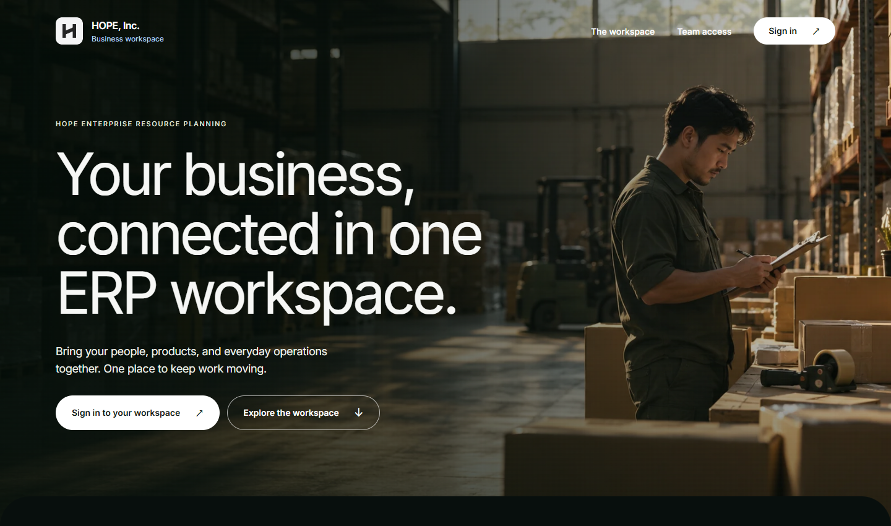

  <h1>HOPE, Inc. ERP</h1>
  
<strong>People, products, and everyday operations in one workspace.</strong>

  
Developed by Team BAIYOGESIC · Software Engineering 1

## About the project

HOPE, Inc. ERP is a web-based enterprise resource planning platform that brings customer relationships, product pricing, employee records, and sales into a shared workspace. It helps teams follow the full sales process—from selecting a customer and applying the price effective on the transaction date to recording payments and tracking outstanding balances.

Role-based permissions give each team member access to the tools and information they need. Historical records, audit logs, and printable reports help administrators review changes and keep daily operations organized.

## Project documentation

See the [project documentation](docs/PROJECT_DOCUMENTATION.md) for current status, completion estimate, architecture, setup instructions, testing results, roadmap, and the live project tracker.

## Key capabilities

- **Customers & sales** — Maintain customer records and payment terms, create itemized sales transactions, and track payments and balances.
- **Products & pricing** — Manage the product catalog and dated price history, with automatic price lookup for each transaction date.
- **People & job history** — Organize employee records, departments, and job assignments, with restricted access to salary information.
- **Reports** — Generate printable product, employee, and sales reports, including top customers and products.
- **Access & accountability** — Manage user roles and module permissions, and review changes through a dedicated audit trail.

## Built with

<table align="center">
  <thead>
    <tr>
      <th align="center">Layer</th>
      <th align="center">Technologies</th>
    </tr>
  </thead>
  <tbody>
    <tr><td align="center">Frontend</td><td align="center">React · TypeScript · Vite · Tailwind CSS</td></tr>
    <tr><td align="center">Backend</td><td align="center">Node.js · Express</td></tr>
    <tr><td align="center">Database</td><td align="center">PostgreSQL · Supabase</td></tr>
    <tr><td align="center">Quality &amp; delivery</td><td align="center">Vitest · React Testing Library · GitHub Actions</td></tr>
  </tbody>
</table>

## Development team

<table align="center" width="100%">
  <tr>
    <td align="center" valign="top" width="20%">
       
      <strong>Ryan James M. Gopio</strong> 
      Scrum Master &nbsp; 
      <a href="https://github.com/Raii-stack">@Raii-stack</a>
    </td>
    <td align="center" valign="top" width="20%">
       
      <strong>Prince Nelson J. Aguinaldo Jr.</strong> 
      Test Engineer &nbsp; 
      <a href="https://github.com/princeaguinaldo">@princeaguinaldo</a>
    </td>
    <td align="center" valign="top" width="20%">
       
      <strong>Alain Deiniel S. Montes</strong> 
      UI/UX Developer &nbsp; 
      <a href="https://github.com/alainmnts">@alainmnts</a>
    </td>
    <td align="center" valign="top" width="20%">
       
      <strong>Kathryn Chloe V. Silvestre</strong> 
      Backend Engineer &amp; DB Admin 
      <a href="https://github.com/itsmechloe">@itsmechloe</a>
    </td>
    <td align="center" valign="top" width="20%">
       
      <strong>Marron Beroy</strong> 
      DevSecOps Engineer &nbsp; 
      <a href="https://github.com/Polygonic">@Polygonic</a>
    </td>
  </tr>
</table>
