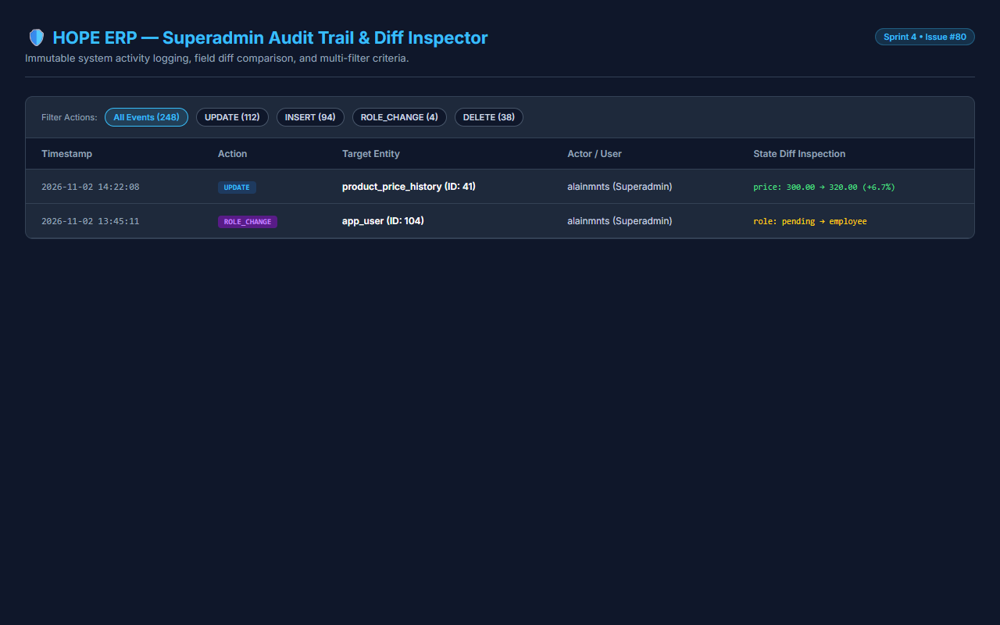

# HOPE, Inc. ERP — Superadmin Audit Log Viewer & Multi-Filter Search Specification

**Sprint:** Sprint 4  
**Author:** Alain Montes (@AlainDeiniel), UI/UX & Frontend Developer  
**Related Issue:** [#80](https://github.com/Raii-stack/BAIYOGESIC/issues/80) (`[S4-DEV-08]`)  

---

## 1. Overview
The Superadmin Audit Log Viewer provides immutable inspection of all critical system transactions, role adjustments, pricing alterations, and permission transitions.

## 2. Key Interface Features
1. **Multi-Filter Action Chips:** Filter logs by action type (`INSERT`, `UPDATE`, `DELETE`, `ROLE_CHANGE`), actor employee, and table target.
2. **Before / After Diff Inspector:** Visual JSON diff highlighting modified fields in green (added/changed) and red (removed).
3. **Role Gating:** Restricted strictly to Superadmin credentials with non-tamperable presentation.
