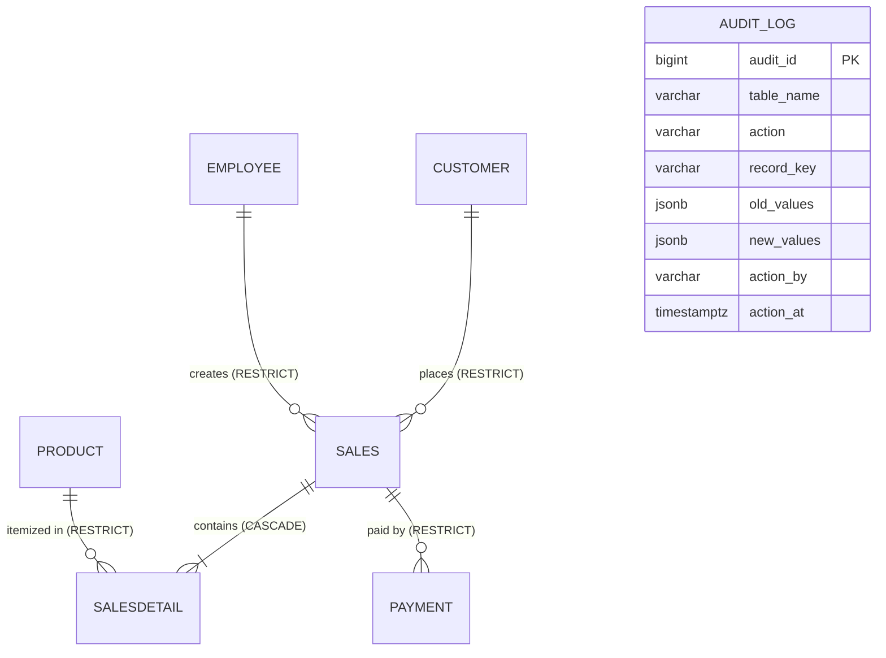

# [S4-DBA-04 & S4-DBA-05] Database: Audit Log Filter Queries & Sales Child Delete Integrity Rules

**Issue Reference:** [#76](https://github.com/Raii-stack/BAIYOGESIC/issues/76)  
**Role:** BackEnd Engineer & DB Admin  
**Module:** HOPE, Inc. ERP (Database Integrity & Audit Logging)  
**Prerequisites:** [#71](https://github.com/Raii-stack/BAIYOGESIC/issues/71) (Sales Transaction Header & Line Items), [#74](https://github.com/Raii-stack/BAIYOGESIC/issues/74) (Sales & Payment Schema & APIs)  
**Database Engine:** PostgreSQL 17.11 (Supabase project `dtcxvlcpqjmutiwejyqk`)  
**Migration:** [`supabase/migrations/20261102010000_issue_76_sales_delete_rules_and_audit_log_queries.sql`](../../supabase/migrations/20261102010000_issue_76_sales_delete_rules_and_audit_log_queries.sql)  

---

## 1. Overview and Scope

This database specification and implementation establishes enterprise-grade referential integrity, delete constraints, two-tier soft/hard delete protections for sales transactions, and optimized audit trail querying procedures within the HOPE, Inc. ERP database.

The core objectives delivered in this specification:
1. **Sales & Payment Orphan Prevention:** Enforce `ON DELETE RESTRICT` semantics on `public.payment(transno)` to guarantee that sales orders with active or historical payments cannot be orphaned or deleted while payment records exist.
2. **Cascading Sales Line Items:** Enforce `ON DELETE CASCADE` semantics on `public.salesdetail(transno)` and automated soft-delete cascading to ensure line items stay strictly synchronized with their parent sales header.
3. **Restricted Master References:** Enforce `ON DELETE RESTRICT` on `sales.custno`, `sales.empno`, and `salesdetail.prodcode` to protect customers, employees, and inventory products from being deleted while active sales records depend on them.
4. **Two-Tier Delete Protection:** Prevent hard deletes via `trg_block_hard_delete` and enforce soft-delete child integrity via `trg_check_children()`, raising PostgreSQL error code `P0001` if archiving a sale with recorded payments is attempted.
5. **Single-Roundtrip Window Pagination for Audit Log:** Implement `public.query_audit_logs(...)` with `count(*) OVER()::integer AS total_count` and composite B-tree indexes for sub-50ms multi-filter querying across table name, action, actor, and timestamp ranges.

---

## 2. Relational Schema and Constraint Architecture

### 2.1 Foreign Key Delete Constraints

All foreign keys safeguarding sales transactions and their child entities are explicitly configured with idempotent PostgreSQL definitions:

| Constraint Name | Source Table | Source Column | Target Table | Target Column | Delete Action | Purpose |
| :--- | :--- | :--- | :--- | :--- | :--- | :--- |
| `sales_custno_fkey` | `public.sales` | `custno` | `public.customer` | `custno` | `ON DELETE RESTRICT` (`confdeltype = 'r'`) | Prevents deleting customer who has sales transactions |
| `sales_empno_fkey` | `public.sales` | `empno` | `public.employee` | `empno` | `ON DELETE RESTRICT` (`confdeltype = 'r'`) | Prevents deleting salesperson who has sales orders |
| `salesdetail_transno_fkey` | `public.salesdetail` | `transno` | `public.sales` | `transno` | `ON DELETE CASCADE` (`confdeltype = 'c'`) | Cascades physical deletion to line items |
| `salesdetail_prodcode_fkey` | `public.salesdetail` | `prodcode` | `public.product` | `prodcode` | `ON DELETE RESTRICT` (`confdeltype = 'r'`) | Prevents deleting product referenced in order lines |
| `payment_transno_fkey` | `public.payment` | `transno` | `public.sales` | `transno` | `ON DELETE RESTRICT` (`confdeltype = 'r'`) | **Guarantees payments can NEVER be orphaned** |

### 2.2 Relational Entity Diagram



---

## 3. Database Triggers & Two-Tier Delete Protection

In accordance with HOPE, Inc. ERP soft-delete architecture:

### 3.1 Hard-Delete Guard (`trg_block_hard_delete`)
Physical `DELETE` and `TRUNCATE` operations are intercepted and aborted on `public.sales`, `public.salesdetail`, and `public.payment`:

```sql
CREATE TRIGGER sales_bd_block
  BEFORE DELETE ON public.sales
  FOR EACH ROW
  EXECUTE FUNCTION public.trg_block_hard_delete();

CREATE TRIGGER salesdetail_bd_block
  BEFORE DELETE ON public.salesdetail
  FOR EACH ROW
  EXECUTE FUNCTION public.trg_block_hard_delete();

CREATE TRIGGER payment_bd_block
  BEFORE DELETE ON public.payment
  FOR EACH ROW
  EXECUTE FUNCTION public.trg_block_hard_delete();
```
*Behavior:* Raises PostgreSQL exception code `P0001` with message:  
`Hard delete/truncate not allowed on <table_name>. Use UPDATE ... SET is_deleted = true.`

### 3.2 Soft-Delete Child Record Guard (`trg_check_children`)
When a sales transaction is soft-deleted (`UPDATE public.sales SET is_deleted = true`), the `BEFORE UPDATE` trigger inspects active payment records:

```sql
WHEN 'sales' THEN
    SELECT count(*) INTO v_n FROM public.payment
     WHERE transno = OLD.transno AND NOT is_deleted;
```

If `v_n > 0`, the transaction is aborted with PostgreSQL error code `P0001`:  
`Cannot delete sales row: % active related record(s) still exist.`

### 3.3 Sales Soft-Delete Cascading Trigger (`trg_sales_cascade_soft_delete`)
When an unpaid sales order header is soft-deleted or restored, its child line items (`salesdetail`) are automatically synchronized at the database level:

```sql
CREATE OR REPLACE FUNCTION public.trg_sales_cascade_soft_delete()
RETURNS trigger
LANGUAGE plpgsql
AS $function$
BEGIN
    IF NEW.is_deleted AND NOT OLD.is_deleted THEN
        UPDATE public.salesdetail
        SET is_deleted = true
        WHERE transno = OLD.transno AND NOT is_deleted;
    ELSIF NOT NEW.is_deleted AND OLD.is_deleted THEN
        UPDATE public.salesdetail
        SET is_deleted = false
        WHERE transno = OLD.transno AND is_deleted;
    END IF;
    RETURN NEW;
END;
$function$;
```

---

## 4. Audit Log Filter Query Procedure & Covering Indexes

To support high-performance audit inspection and the Superadmin Audit Viewer (Issue #80), single-roundtrip window function pagination and composite B-tree indexes are implemented.

### 4.1 Window Pagination Query Function (`query_audit_logs`)

```sql
CREATE OR REPLACE FUNCTION public.query_audit_logs(
    p_table_name varchar DEFAULT NULL,
    p_action varchar DEFAULT NULL,
    p_action_by varchar DEFAULT NULL,
    p_from timestamptz DEFAULT NULL,
    p_to timestamptz DEFAULT NULL,
    p_limit integer DEFAULT 50,
    p_offset integer DEFAULT 0
)
RETURNS TABLE (
    audit_id bigint,
    table_name varchar,
    action varchar,
    record_key varchar,
    old_values jsonb,
    new_values jsonb,
    action_by varchar,
    action_at timestamptz,
    total_count integer,
    _total integer
)
LANGUAGE sql
STABLE
AS $function$
    SELECT
        al.audit_id,
        al.table_name::varchar,
        al.action::varchar,
        al.record_key::varchar,
        al.old_values,
        al.new_values,
        al.action_by::varchar,
        al.action_at,
        count(*) OVER()::integer AS total_count,
        count(*) OVER()::integer AS _total
    FROM public.audit_log al
    WHERE (p_table_name IS NULL OR al.table_name = p_table_name)
      AND (p_action IS NULL OR al.action = p_action)
      AND (p_action_by IS NULL OR al.action_by ILIKE '%' || p_action_by || '%' OR al.action_by = p_action_by)
      AND (p_from IS NULL OR al.action_at >= p_from)
      AND (p_to IS NULL OR al.action_at <= p_to)
    ORDER BY al.action_at DESC, al.audit_id DESC
    LIMIT COALESCE(p_limit, 50)
    OFFSET COALESCE(p_offset, 0);
$function$;
```

### 4.2 Composite Covering Indexes

```sql
-- Multi-filter index by table and reverse chronological timestamp
CREATE INDEX IF NOT EXISTS audit_log_table_action_at_idx
  ON public.audit_log (table_name, action_at DESC);

-- Multi-filter index by user/actor and timestamp
CREATE INDEX IF NOT EXISTS audit_log_actor_action_at_idx
  ON public.audit_log (action_by, action_at DESC);

-- Multi-filter index by action type (ADD, EDIT, DELETE, PRICE_UPDATE)
CREATE INDEX IF NOT EXISTS audit_log_action_at_idx
  ON public.audit_log (action, action_at DESC);

-- Composite covering index for compound table + action filtering
CREATE INDEX IF NOT EXISTS audit_log_composite_filter_idx
  ON public.audit_log (table_name, action, action_at DESC);
```

---

## 5. Application Layer Error Handling Alignment

The API controller in `controllers/sales-controller.js` maps database-level trigger exceptions and foreign key violations into standard HTTP responses:

| PostgreSQL Code | Exception Condition | HTTP Status | Response Message |
| :--- | :--- | :--- | :--- |
| `P0001` | `trg_check_children()` catches active payments on soft-delete | `409 Conflict` | `Cannot archive a sales order that already has recorded payments.` |
| `23503` | `payment_transno_fkey` constraint violation (`ON DELETE RESTRICT`) | `409 Conflict` | `Cannot archive a sales order that already has recorded payments.` |
| `400 Bad Request` | Payment amount exceeds outstanding transaction balance | `400 Bad Request` | `Payment amount (...) exceeds remaining balance (...)` |
| `400 Bad Request` | Zero or negative item quantity submitted | `400 Bad Request` | `Quantity must be greater than zero` |

---

## 6. Verification and Testing Runbook

### 6.1 SQL Constraint Inspection

Verify foreign key constraints in Supabase SQL editor or `psql`:

```sql
SELECT
    conname AS constraint_name,
    conrelid::regclass AS table_name,
    confrelid::regclass AS foreign_table_name,
    confdeltype AS delete_action
FROM pg_constraint
WHERE conname IN (
    'sales_custno_fkey',
    'sales_empno_fkey',
    'salesdetail_transno_fkey',
    'salesdetail_prodcode_fkey',
    'payment_transno_fkey'
);

-- Expected Output:
-- sales_custno_fkey        | sales       | customer | r (RESTRICT)
-- sales_empno_fkey         | sales       | employee | r (RESTRICT)
-- salesdetail_transno_fkey | salesdetail | sales    | c (CASCADE)
-- salesdetail_prodcode_fkey| salesdetail | product  | r (RESTRICT)
-- payment_transno_fkey     | payment     | sales    | r (RESTRICT)
```

### 6.2 Audit Log Window Function Query Test

```sql
-- Query audit log for sales transactions in the last 30 days
SELECT * FROM public.query_audit_logs(
    p_table_name => 'sales',
    p_action => NULL,
    p_action_by => NULL,
    p_from => NOW() - INTERVAL '30 days',
    p_to => NOW(),
    p_limit => 10,
    p_offset => 0
);
```

### 6.3 Automated Test Suite Execution

Run the full validation suite:

```bash
# 1. QA Unit Test Suite (Schema, Triggers, Functions & Controller Mappings)
npm run test:unit

# 2. Vitest Test Suite (Components, Integration, and Calculation Logic)
npm test

# 3. Migration Sequence and Timestamp Verification
npm run verify:migrations

# 4. Code Quality and Syntax Verification
npm run lint

# 5. Production Application Build
npm run build
```
