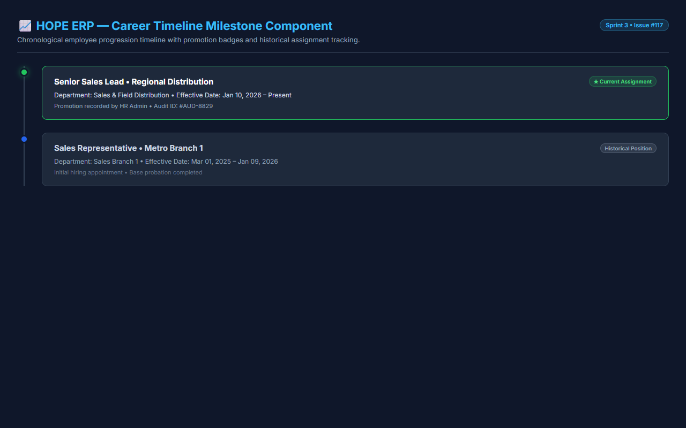

# HOPE, Inc. ERP — Employee Career Timeline Component Specification

**Sprint:** Sprint 3  
**Author:** Alain Montes (@AlainDeiniel), UI/UX & Frontend Developer  
**Related Issue:** [#117](https://github.com/Raii-stack/BAIYOGESIC/issues/117) (`[S3-UIX-02]`)  

---

## 1. Overview
The Career Timeline component (`CareerTimeline.tsx`) displays an employee's historical journey across promotions, department transfers, and title adjustments in an intuitive chronological timeline.

## 2. Component Design Highlights
- **Chronological Vertical Rail:** Connected milestone nodes with distinct markers for the **Current Assignment** versus historical positions.
- **Adaptive Breakpoints:**
  - Desktop (≥1024px): 4-column row displaying effective dates, department, job role, and compensation.
  - Mobile (<768px): Stacks into compact cards maintaining timeline continuity without horizontal table scrolling.
- **Audit Stamp Tooltips:** Displays creator stamp and effective timestamp for authorized supervisory roles.
