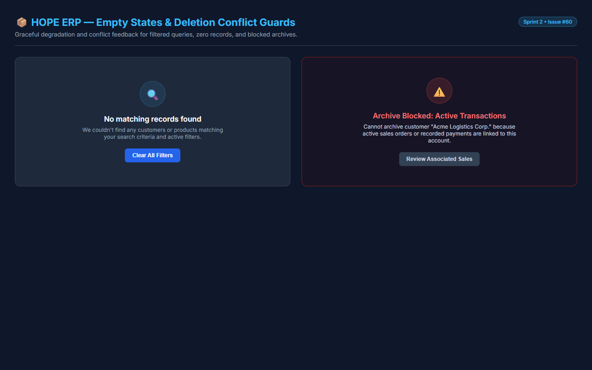

# HOPE, Inc. ERP — CRM & Inventory Empty, Error, and Delete State Guidelines

**Sprint:** Sprint 2  
**Author:** Alain Montes (@AlainDeiniel), UI/UX & Frontend Developer  
**Related Issue:** [#60](https://github.com/Raii-stack/BAIYOGESIC/issues/60) (`[S2-UIX-04 & S2-UIX-05]`)  

---

## 1. Overview
Sprint 2 introduced comprehensive handling for zero-data scenarios, network failure alerts, and active transaction dependency guards across the Customer and Product directories.

## 2. Interaction Specifications
1. **Empty Directory State:**
   - Differentiates between a completely empty database and empty search results.
   - For empty search results, provides a single "Clear all filters" call-to-action button that restores pagination and default sorting.
2. **Network & Server Failure Banners:**
   - Non-blocking red alert box announcing the server error message with a dedicated "Try again" retry trigger.
3. **Archive / Deletion Conflict Alerts:**
   - Displays HTTP 409 conflict notifications directly inside the open confirmation modal when records are tied to active sales orders.
