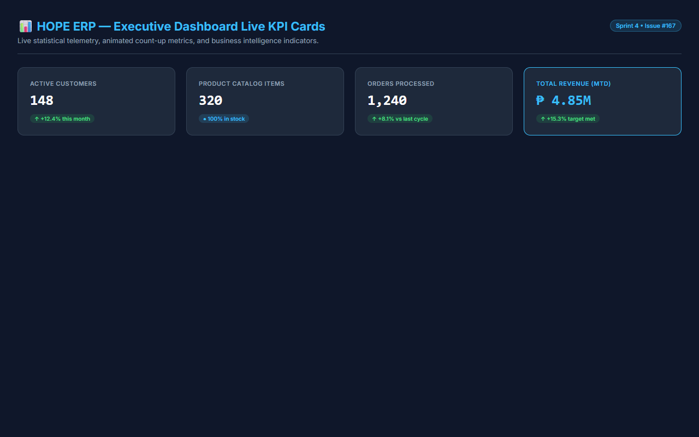

# HOPE, Inc. ERP — Live Dashboard KPI Statistic Cards Specification

**Sprint:** Sprint 4  
**Author:** Alain Montes (@AlainDeiniel), UI/UX & Frontend Developer  
**Related Issue:** [#167](https://github.com/Raii-stack/BAIYOGESIC/issues/167) (`[S4-DEV-09]`)  

---

## 1. Overview
The primary ERP Dashboard displays 4 live KPI metric cards (Active Customers, Product Catalog, Open Orders, and Monthly Revenue) with count-up animations and role-gated quick actions.

## 2. Key Interface Specifications
1. **Live Metric Cards:**
   - Active Customers: Total active customer accounts with month-over-month growth pill.
   - Product Catalog: Total distinct catalog items with low-stock alerts.
   - Orders Processed: Active transaction count in the current cycle.
   - Total Revenue: Formatted aggregate revenue in Philippine Pesos.
2. **Count-Up Animation (`CountUpValue.tsx`):** Smooth 800ms easing animation on initial load and cache refresh.
3. **Skeleton Loading:** Shimmer loading cards displayed while telemetry endpoints resolve.
