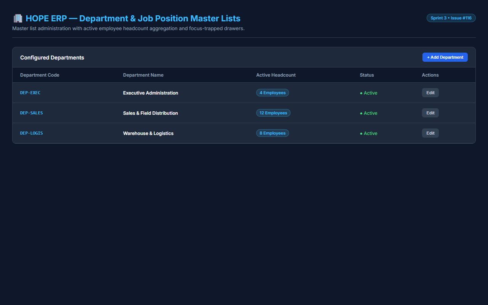

# HOPE, Inc. ERP — Department & Job Position Management Drawers Specification

**Sprint:** Sprint 3  
**Author:** Alain Montes (@AlainDeiniel), UI/UX & Frontend Developer  
**Related Issue:** [#116](https://github.com/Raii-stack/BAIYOGESIC/issues/116) (`[S3-UIX-01]`)  

---

## 1. Overview
The Department & Job Position Management interface provides dedicated slide-over drawers for managing organizational hierarchies, department headcounts, and job title master records.

## 2. Key Interface Specifications
1. **Slide-Over Modal Architecture:** Fixed right slide-over panel with dark overlay (`bg-slate-950/80 backdrop-blur-sm`).
2. **Focus Containment Lifecycle:** Initial focus lands on Department Code; Escape closes only when idle; focus returns to trigger on exit.
3. **Inline Mutation:** Updating department metadata updates the directory table immediately without full re-fetching.
