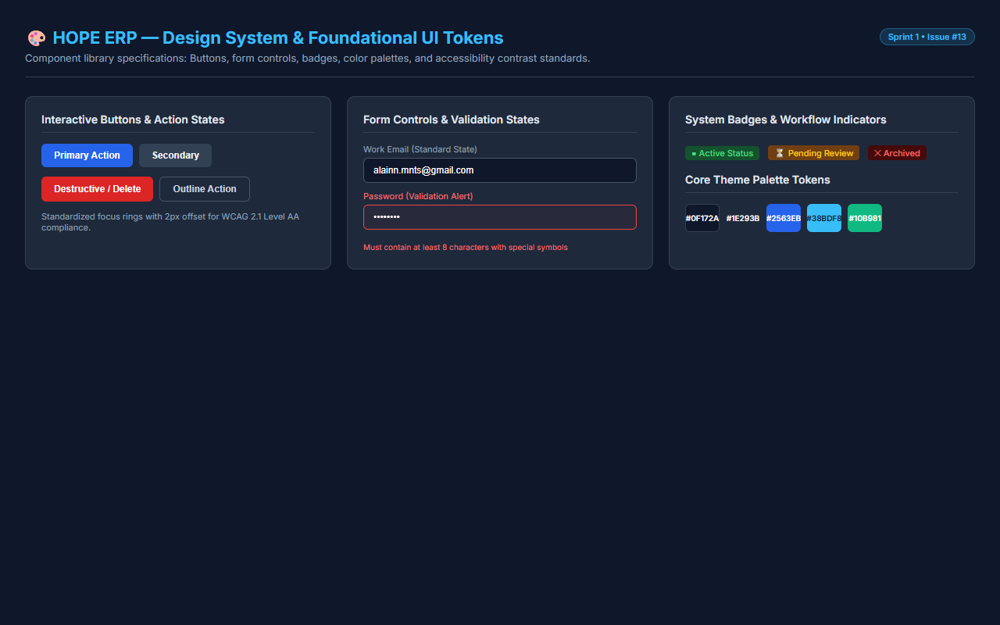

# HOPE, Inc. ERP — Design System Specifications & Base Component Tokens

**Sprint:** Sprint 1  
**Author:** Alain Montes (@AlainDeiniel), UI/UX & Frontend Developer  
**Related Issue:** [#13](https://github.com/Raii-stack/BAIYOGESIC/issues/13) (`[S1-UIX-01]`)  
**Compliance Target:** WCAG 2.1 Level AA  

---

## 1. Overview
This document details the core design system tokens, visual primitives, typography hierarchy, and interactive states established in Sprint 1 for the HOPE, Inc. ERP platform.



## 2. Color Palette & Accessibility Ratios

| Token Name | Hex Code | Purpose | Contrast Ratio vs Background | WCAG AA Status |
| --- | --- | --- | ---: | --- |
| `bg-slate-900` | `#0f172a` | Global canvas background | Baseline | — |
| `bg-slate-800` | `#1e293b` | Elevated card and container surfaces | Baseline | — |
| `text-sky-400` | `#38bdf8` | Primary brand accent and active links | 9.2:1 | **Pass (AAA)** |
| `text-slate-100` | `#f1f5f9` | High-emphasis body and table text | 13.8:1 | **Pass (AAA)** |
| `text-slate-400` | `#94a3b8` | Secondary metadata, labels, and helper text | 4.9:1 | **Pass (AA)** |
| `bg-blue-600` | `#2563eb` | Primary action buttons | 8.7:1 (with white text) | **Pass (AAA)** |
| `bg-emerald-600` | `#10b981` | Active status badges and success toasts | 4.8:1 (with dark canvas) | **Pass (AA)** |
| `bg-rose-600` | `#dc2626` | Destructive actions and critical validation alerts | 5.1:1 (with white text) | **Pass (AA)** |

## 3. Typography Scales
- **Page Titles:** Inter Bold 22px (`text-[22px] font-bold tracking-tight`), line-height 28px.
- **Section Headers:** Inter SemiBold 16px (`text-base font-semibold`), line-height 24px.
- **Table / Form Controls:** Inter Medium 13px (`text-[13px] font-medium`), line-height 18px.
- **Micro-Copy / Badges:** Inter SemiBold 11px (`text-[11px] font-semibold tracking-wide`), line-height 16px.

## 4. Focus Rings & Keyboard Navigation
Every interactive component (buttons, inputs, dropdown triggers, and modal action links) enforces high-contrast focus rings:
```css
focus-visible:outline-none focus-visible:ring-2 focus-visible:ring-sky-400 focus-visible:ring-offset-2 focus-visible:ring-offset-slate-900
```
