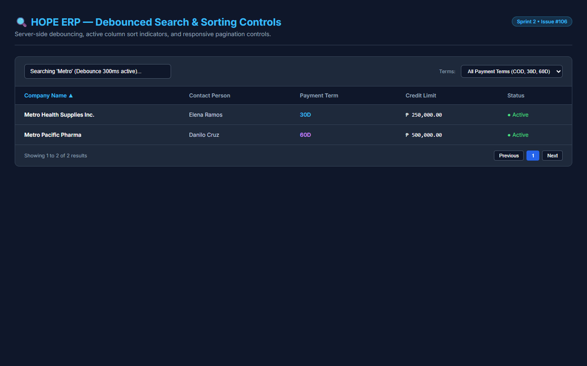

# HOPE, Inc. ERP — Customer & Product Directory Search, Sorting & Pagination Controls

**Sprint:** Sprint 2  
**Author:** Alain Montes (@AlainDeiniel), UI/UX & Frontend Developer  
**Related Issue:** [#106](https://github.com/Raii-stack/BAIYOGESIC/issues/106) (`[S2-UIX-01]`)  

---

## 1. Overview
This specification details the frontend search debouncing (300ms), multi-column table sorting indicators, and dynamic pagination controls implemented for Customer and Product directory tables.

## 2. Technical Implementation Highlights
- **Debounced Search (`useDebouncedValue`):** Delays API query dispatch by 300ms of typing inactivity to prevent query thrashing against Postgres GIN trigram indexes.
- **Roving Sort Header Indicators:** Clean visual chevron icons (`↑` / `↓`) indicating sort field and ascending/descending direction, syncing directly to URL query parameters (`?sort=company_name&order=asc`).
- **Page Size Selectors:** Options for 10, 25, 50, and 100 records per page, automatically resetting the page pointer to 1 upon dimension change.
