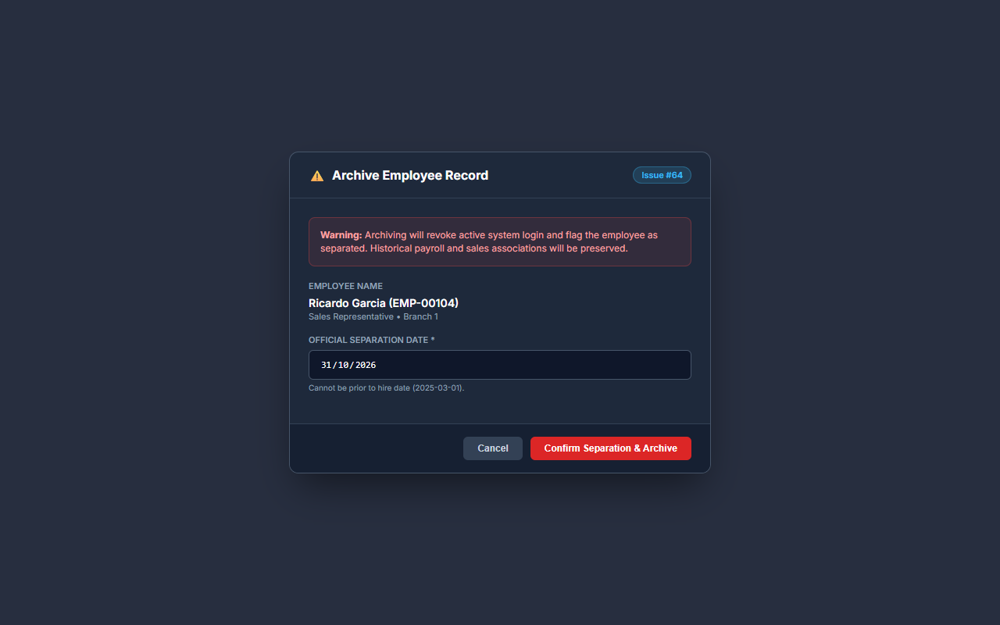

# HOPE, Inc. ERP — Employee Soft Delete, Separation Date & Archive Workflow Specification

**Sprint:** Sprint 3  
**Author:** Alain Montes (@AlainDeiniel), UI/UX & Frontend Developer  
**Related Issue:** [#64](https://github.com/Raii-stack/BAIYOGESIC/issues/64) (`[S3-DEV-05]`)  

---

## 1. Overview
The Employee Archive workflow safely transitions active personnel to archived status while requiring a mandatory separation date and enforcing active-transaction integrity guards.

## 2. Interaction Specifications
1. **Separation Date Validation:** Enforces that separation dates cannot precede the employee's original hiring date.
2. **Active Sales Transaction Blocker:** If the employee is assigned as the sales representative on active orders, the modal surfaces a non-dismissible HTTP 409 conflict banner explaining the block.
3. **Status Pill Transition:** Post-archive, employee badges update from green `Active` to gray `Archived` in-place without page reloading.
