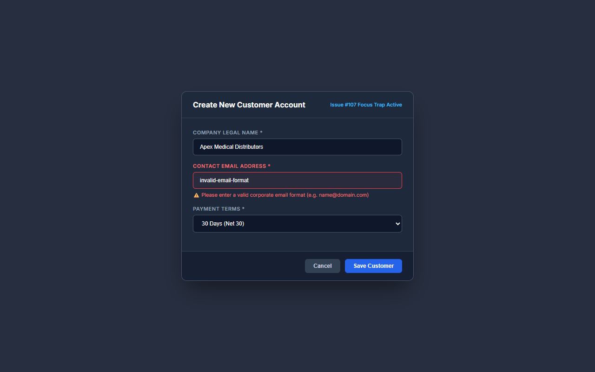

# HOPE, Inc. ERP — Accessible Modal Form Validation & Focus Management Specification

**Sprint:** Sprint 2  
**Author:** Alain Montes (@AlainDeiniel), UI/UX & Frontend Developer  
**Related Issue:** [#107](https://github.com/Raii-stack/BAIYOGESIC/issues/107) (`[S2-UIX-02]`)  
**Compliance:** WCAG 2.1 Level AA  

---

## 1. Overview
Modal dialogs across Customer, Product, and User creation require strict accessible focus containment and real-time field validation without clearing user input.

## 2. Accessibility & Validation Standards
1. **Focus Containment & Trap:**
   - On open, focus lands automatically on the first editable input.
   - `Tab` and `Shift+Tab` wrap within the modal's focusable bounds.
   - `Escape` dismisses the modal only when no asynchronous save is in progress.
2. **Accessible Validation Indicators:**
   - Field errors connect via `aria-invalid="true"` and `aria-describedby="[field]-error"`.
   - Distinct red border (`#ef4444`) paired with explanatory micro-copy prevents reliance on color alone.
