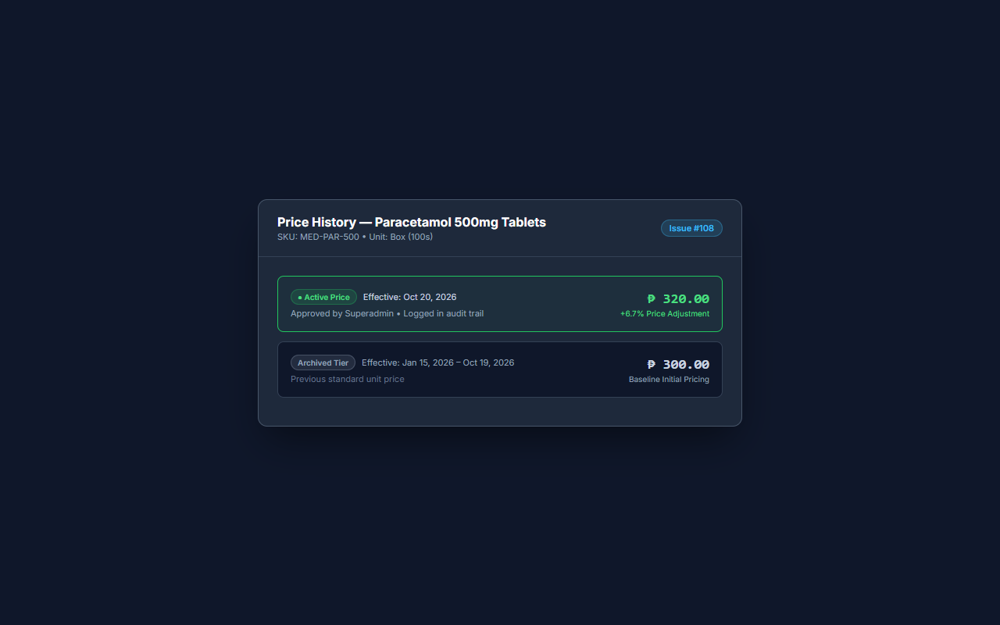

# HOPE, Inc. ERP — Product Price History Timeline Modal & Price Trend Visualization

**Sprint:** Sprint 2  
**Author:** Alain Montes (@AlainDeiniel), UI/UX & Frontend Developer  
**Related Issue:** [#108](https://github.com/Raii-stack/BAIYOGESIC/issues/108) (`[S2-UIX-03]`)  

---

## 1. Overview
The Price History Timeline modal (`PriceHistoryModal`) provides authorized users with a complete chronological inspection of effective price changes for any inventory item.

## 2. Key Features
1. **Effective-Dated Price Tiers:** Clearly marks the currently active unit price with a green badge, sorting previous historical tiers in reverse chronological order.
2. **Role-Gated Audit Stamps:** Standard users see prices and effective dates, while creator metadata and modification timestamps are visible only to Managerial/Admin roles.
3. **Price Change Delta Indicators:** Visually indicates percentage price adjustments (`+5.2%` or `-2.1%`) between successive price updates.
