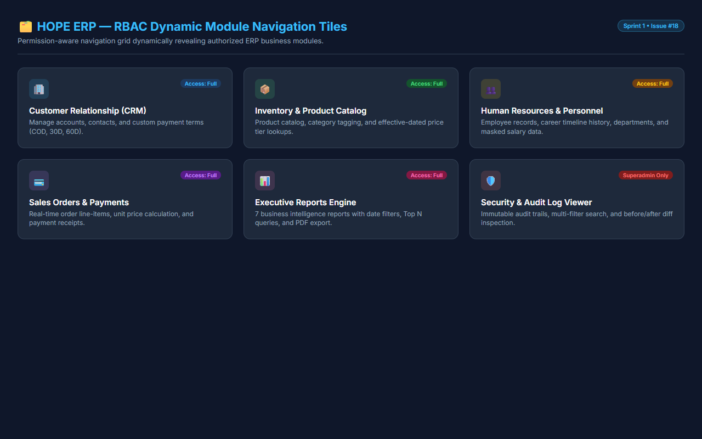

# HOPE, Inc. ERP — RBAC Dynamic Module Navigation Tiles Specification

**Sprint:** Sprint 1  
**Author:** Alain Montes (@AlainDeiniel), UI/UX & Frontend Developer  
**Related Issue:** [#18](https://github.com/Raii-stack/BAIYOGESIC/issues/18) (`[S1-DEV-08b]`)  

---

## 1. Overview
The RBAC Dynamic Module Navigation system renders primary ERP application tiles conditionally based on the user's assigned role and granular module permissions.

## 2. Dynamic Tile Rendering Matrix

| Module Tile | Superadmin | Admin | Employee / Staff | Gating Permission |
| --- | :---: | :---: | :---: | --- |
| **CRM & Customers** | Full (CRUD) | Full (CRUD) | View / Edit Assigned | `can_view_customers` |
| **Product Inventory** | Full (CRUD) | Full (CRUD) | View Only | `can_view_products` |
| **Human Resources** | Full (CRUD) | Department Scoped | Hidden / Restricted | `can_view_hr` |
| **Sales Lifecycle** | Full (CRUD) | Full (CRUD) | Create & View Own | `can_view_sales` |
| **Reports Engine** | All 7 Reports | Assigned Reports | Executive View | `can_view_reports` |
| **Audit Log Viewer** | Global Access | Restricted | Hidden | Superadmin Role Only |

## 3. Responsive Tile Card Design
Each module tile displays an icon, high-contrast title, concise capability summary, and dynamic item count badge updated via client-side cache or server endpoints.
