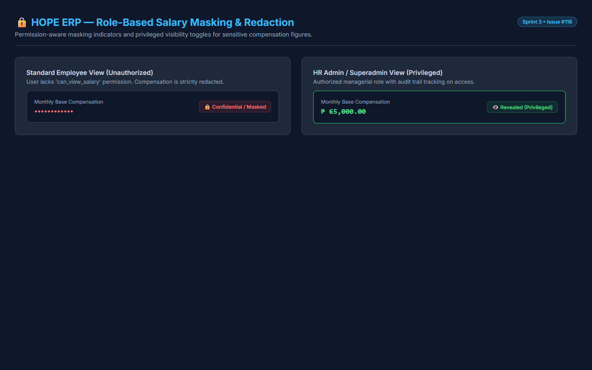

# HOPE, Inc. ERP — Role-Based Salary Masking & PII Redaction Specification

**Sprint:** Sprint 3  
**Author:** Alain Montes (@AlainDeiniel), UI/UX & Frontend Developer  
**Related Issue:** [#118](https://github.com/Raii-stack/BAIYOGESIC/issues/118) (`[S3-UIX-03]`)  

---

## 1. Overview
This specification details the client-side and presentation layer enforcement of salary masking and PII redaction across the Employee Directory and Profile pages.

## 2. Security & Presentation Principles
1. **Never Replace With Numeric Placeholders:** When compensation data is withheld, the UI renders a prominent lock badge labeled **"Confidential / Masked"** rather than displaying zeroes or falsified figures.
2. **Role-Gated Reveal Toggle:** For authorized HR/Superadmin users with explicit permission, an interactive "Reveal" toggle button unlocks formatted currency values.
3. **Screen Reader Announcement:** Screen readers announce: *"Compensation data is masked due to role permissions"* preventing accessibility confusion.
