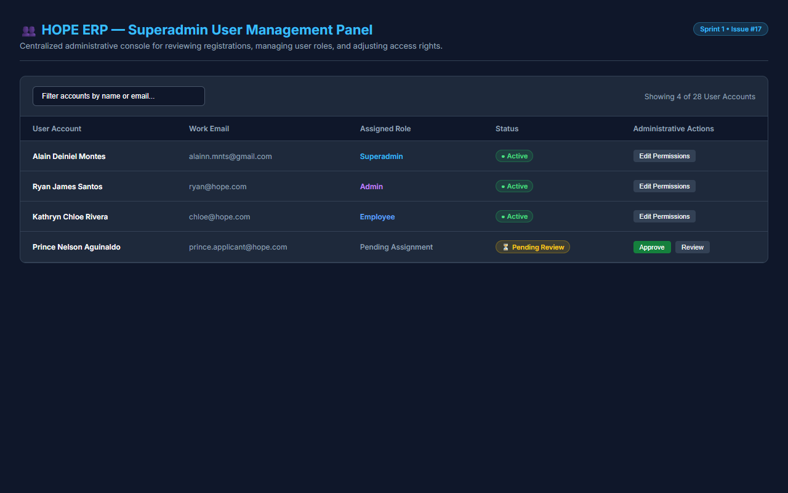

# HOPE, Inc. ERP — Superadmin User Management Panel Specification

**Sprint:** Sprint 1  
**Author:** Alain Montes (@AlainDeiniel), UI/UX & Frontend Developer  
**Related Issue:** [#17](https://github.com/Raii-stack/BAIYOGESIC/issues/17) (`[S1-DEV-06b & S1-DEV-07b]`)  

---

## 1. Overview
The Superadmin User Management interface (`/users`) provides administrative personnel with tools to inspect active user accounts, approve pending self-registrations, adjust role assignments, and configure granular permissions.

## 2. Key Interface Features
1. **Multi-Filter Search Bar:** Real-time search across employee names and email addresses with debounced filtering.
2. **Account Status Badges:**
   - `active`: Green badge indicating full access to permitted modules.
   - `pending`: Yellow badge indicating a newly registered user awaiting administrator review.
   - `rejected`: Red badge indicating unapproved or suspended accounts.
3. **Slide-Over User Profile Drawer:** Focus-trapped slide-over dialog enabling password resets, status transitions, and rights customization without full page navigation.
