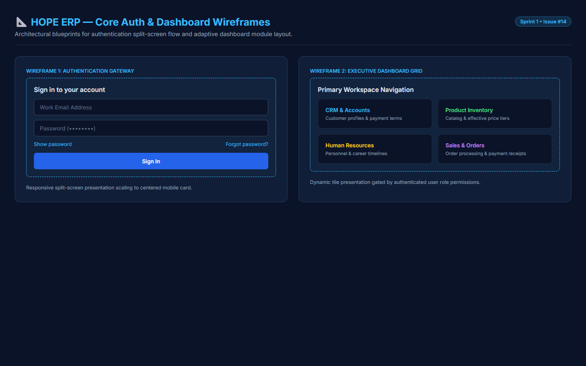

# HOPE, Inc. ERP — Core Auth & Dashboard Wireframes Specification

**Sprint:** Sprint 1  
**Author:** Alain Montes (@AlainDeiniel), UI/UX & Frontend Developer  
**Related Issue:** [#14](https://github.com/Raii-stack/BAIYOGESIC/issues/14) (`[S1-UIX-02 & S1-UIX-03]`)  

---

## 1. Overview
This specification documents the foundational wireframes and structural layout systems designed for the authentication gateway and primary dashboard navigation in Sprint 1.

## 2. Authentication Gateway Architecture
- **Dual-Pane Desktop Layout (≥1024px):**
  - Left pane: Branded hero presentation with ERP identity, security highlights, and feature overview.
  - Right pane: Focused form container hosting sign-in, registration dialog trigger, and password recovery.
- **Single-Column Mobile Stack (<1024px):**
  - Centered auth card with 44px minimum interactive touch targets.
  - Pinned footer maintaining copyright and compliance disclosures.

## 3. Dashboard Grid & Navigation Shell
- **Top Navigation Bar:** Persistent workspace identity, search trigger (`Ctrl+K`), active notification badges, and user profile drawer trigger.
- **Module Grid:** Responsive 1-to-4 column cards displaying role-permitted modules with dynamic action counts.
