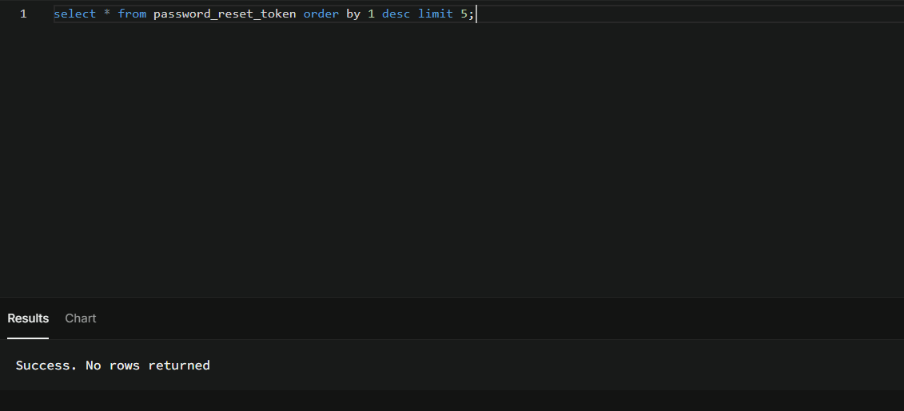

# Sprint 1 Bug Log

## BUG-001: Registration returns 503 for a valid request
**Severity:** High | **Status:** Open | **Found by:** Prince Nelson J. Aguinaldo Jr. | **Test:** TC-AUTH-01

**Environment:** local API (`npm run api:dev`), branch main, test Supabase project

**Steps to Reproduce:**
1. Start the API.
2. Send `POST /api/auth/register` with body
   `{ "firstName": "QA", "lastName": "Tester", "email": "qa+test@test.com" }`

**Expected:** 201 with `{ success: true }`.

**Actual:** 503
`{ "success": false, "error": { "message": "Server authentication credentials are not authorized to read app_user", "statusCode": 503 } }`

**Suspected cause:** `register` in `controllers/auth-controller.js` reads `app_user` with `supabase` (SUPABASE_KEY), while `login` uses `authSupabase` (service role). The read is denied with error code 42501.

**Related concern (to check after the fix):** `register` never inserts the new user into `app_user`, so even a 201 would not create an account.

**Screenshot/log:** attach a screenshot of the failing Jest output.

## BUG-002: Forgot-password and reset-password endpoints still exposed after feature removal
**Severity:** Medium | **Status:** Open | **Found by:** Prince Nelson J. Aguinaldo Jr. | **Tests:** `tests/integration/auth.test.js` (Removed features stay removed)

**Environment:** local API (`npm run api:dev`), branch main, test Supabase project

**Steps to Reproduce:**
1. Start the API.
2. Send `POST /api/auth/forgot-password` with body `{ "email": "x@test.com" }`.
3. Send `POST /api/auth/reset-password` with body `{ "email": "x@test.com" }`.

**Expected:** Both return 404, because the team removed forgot-password and registration from scope on 10/26/2026.

**Actual:** 
- `forgot-password` returns **200**.
- `reset-password` returns **400** (it validates the request, so the route exists).
- `register` correctly returns 404.

**Impact:** Removed features remain reachable. Possible token creation in `password_reset_token` [confirm from SQL check: new rows appeared / no new rows]. Unused auth endpoints add attack surface.

**Suggested fix:** Remove the routes (and the unused controller code) or confirm they are intentionally kept.

**Evidence:** screenshots of the failing test output and the `password_reset_token` query.

## BUG-003: Playwright E2E runner does not start the application
**Severity:** Medium | **Status:** Resolved | **Found by:** Test Engineer | **Test:** `npm run test:e2e`

**Environment:** local Windows development environment, Node.js 24.22.0

**Steps to Reproduce:**
1. Stop the frontend and API development servers.
2. Run `npm run test:e2e`.

**Expected:** Playwright starts the app and runs browser tests against its configured base URL.

**Actual:** Browser tests failed with `net::ERR_CONNECTION_REFUSED` at `http://127.0.0.1:5173`; the Playwright configuration did not declare a `webServer`.

**Fix:** Configure Playwright to use the existing `npm run dev` launcher and bind Vite to `127.0.0.1` so the readiness URL and server address match.

**Verification:** `npx playwright test tests/e2e/ui-consistency.spec.js --config=playwright.config.js` passed all 10 tests. The full E2E suite was not green during this run; see the S1-TST-06 report.

**Screenshot/log:** No browser screenshot applies because the failure occurred before a page loaded. The terminal failure was captured during the test run; Playwright's failure artifacts were cleared by the subsequent passing run.

## BUG-004: UI consistency E2E mock omits registration notifications
**Severity:** Low | **Status:** Resolved | **Found by:** Test Engineer | **Test:** `tests/e2e/ui-consistency.spec.js`

**Environment:** local Playwright run against Vite

**Steps to Reproduce:**
1. Run the UI consistency Playwright spec with its API mock enabled.
2. Load an authenticated workspace page.

**Expected:** All API requests used by the page receive mocked responses, allowing the UI assertions to run.

**Actual:** The mock threw `Unhandled API: /api/auth/registration-notifications`, causing the workspace and pagination tests to fail before completing their assertions.

**Fix:** Add the endpoint to the shared E2E mock with an empty notifications response.

**Verification:** The UI consistency spec passed all 10 tests after the mock was added.

**Screenshot/log:** No screenshot was retained; Playwright cleared the failed-run artifacts after the passing rerun. The earlier failure message is recorded in the S1-TST-06 report.