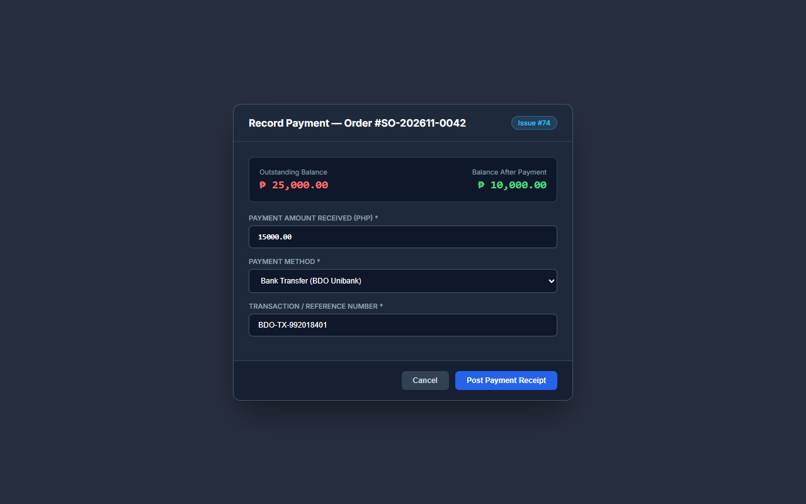

# HOPE, Inc. ERP — Payment Recording Modal & Transaction Balance Calculation Specification

**Sprint:** Sprint 4  
**Author:** Alain Montes (@AlainDeiniel), UI/UX & Frontend Developer  
**Related Issue:** [#74](https://github.com/Raii-stack/BAIYOGESIC/issues/74) (`[S4-DEV-03 & S4-DEV-06]`)  

---

## 1. Overview
The Record Payment workflow (`RecordPaymentModal.tsx`) enables accounting staff to apply customer payments against sales orders, validating against remaining balance and updating transaction status.

## 2. Interaction Specifications
1. **Dynamic Balance Deduction:** Entering an amount automatically displays remaining balance after payment (`Remaining = Current Balance - Payment`).
2. **Payment Method Selectors:** Supports Cash, Check, Bank Transfer, and Credit Terms with reference numbering fields.
3. **Overpayment Prevention:** Disables submission and alerts user if payment exceeds the outstanding order balance.
