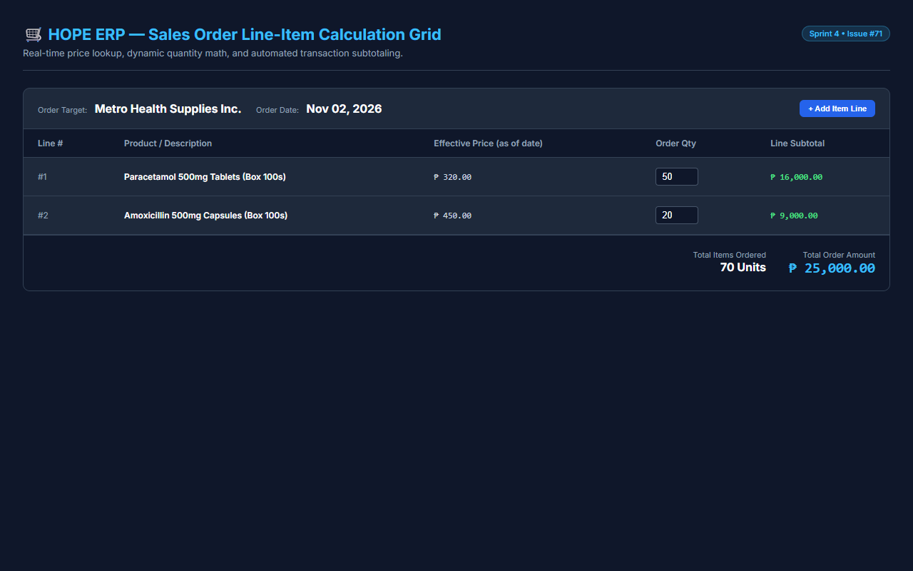

# HOPE, Inc. ERP — Sales Order Line Item Grid & Real-Time Price Lookup Specification

**Sprint:** Sprint 4  
**Author:** Alain Montes (@AlainDeiniel), UI/UX & Frontend Developer  
**Related Issue:** [#71](https://github.com/Raii-stack/BAIYOGESIC/issues/71) (`[S4-DEV-01 & S4-DEV-02]`)  

---

## 1. Overview
The Sales Order Entry screen (`/sales/new`) provides an interactive line-item calculation grid that looks up effective product prices as-of order date and computes line subtotals in real-time.

## 2. Interaction Specifications
1. **Dynamic Line Addition / Removal:** Users can add multiple product lines, specify quantities, and delete rows with immediate summary recalculations.
2. **Effective Price as-of-Date:** Automatically queries the product's effective price tier on or immediately preceding the selected order date.
3. **Currency Precision & Formatting:** All monetary figures enforce 2-decimal Philippine Peso formatting (`₱ #,##0.00`).
